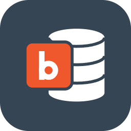
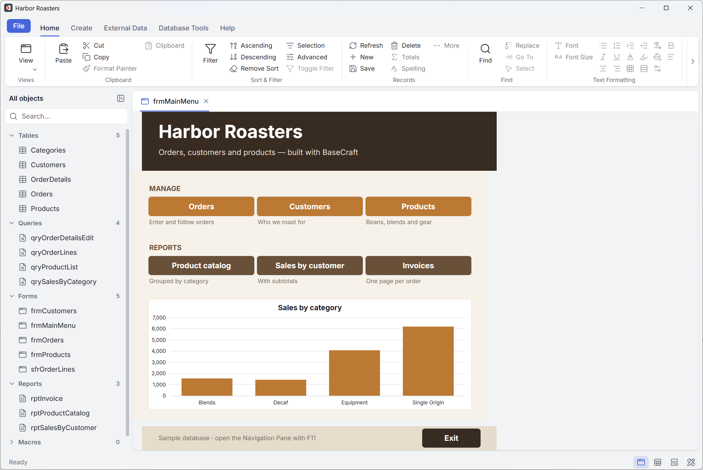
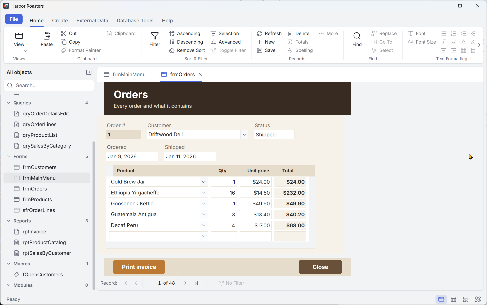
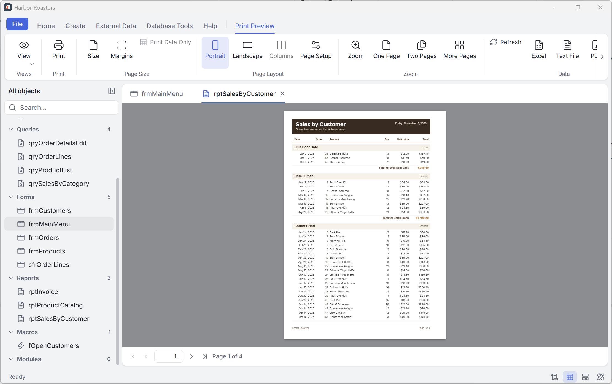
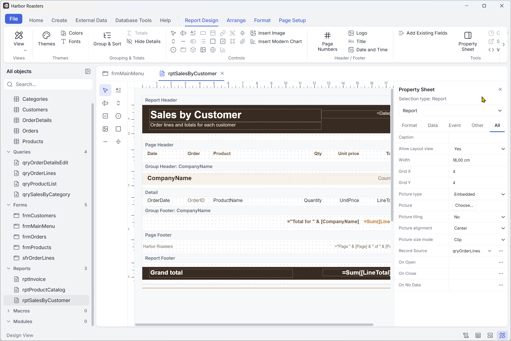
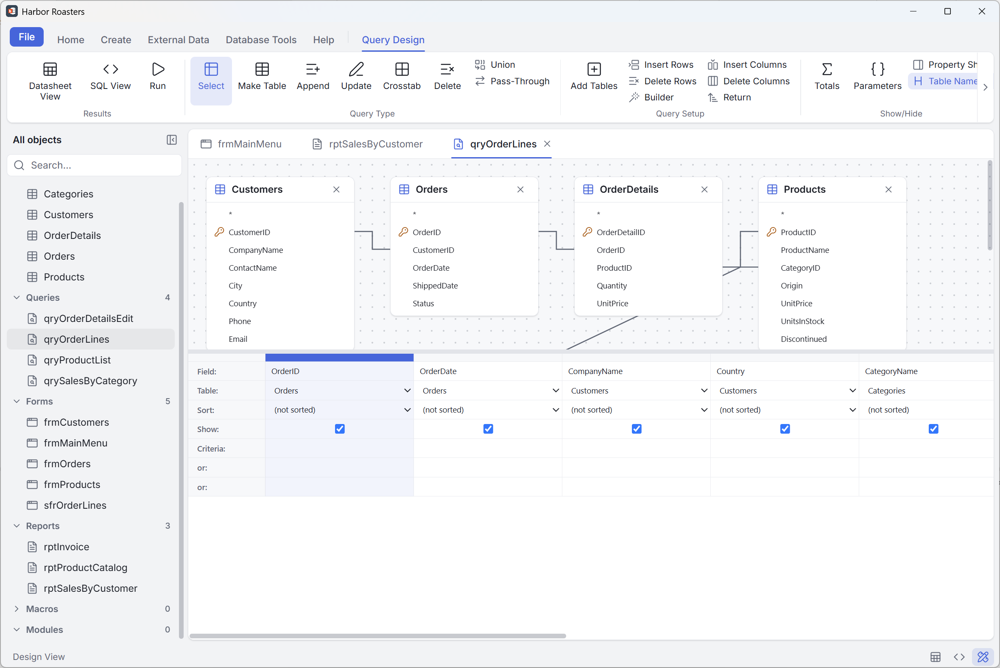
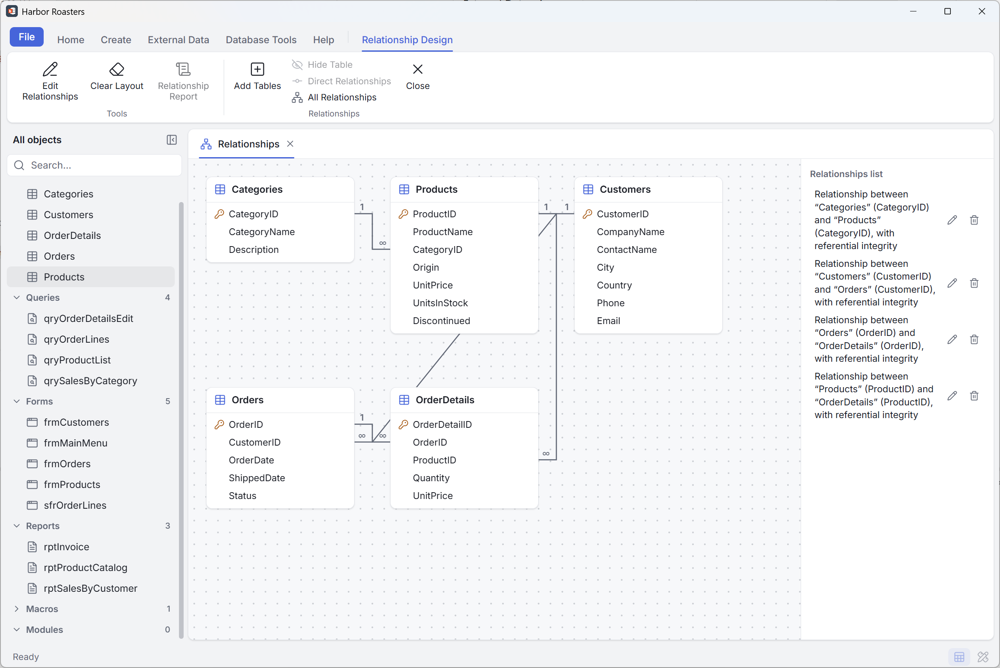
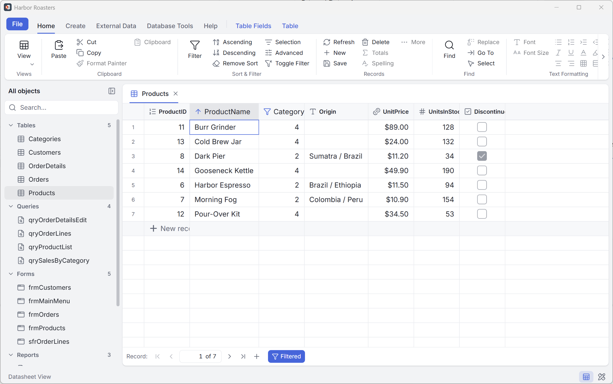
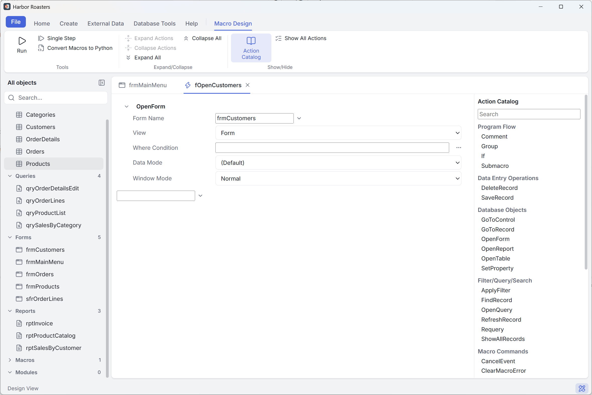
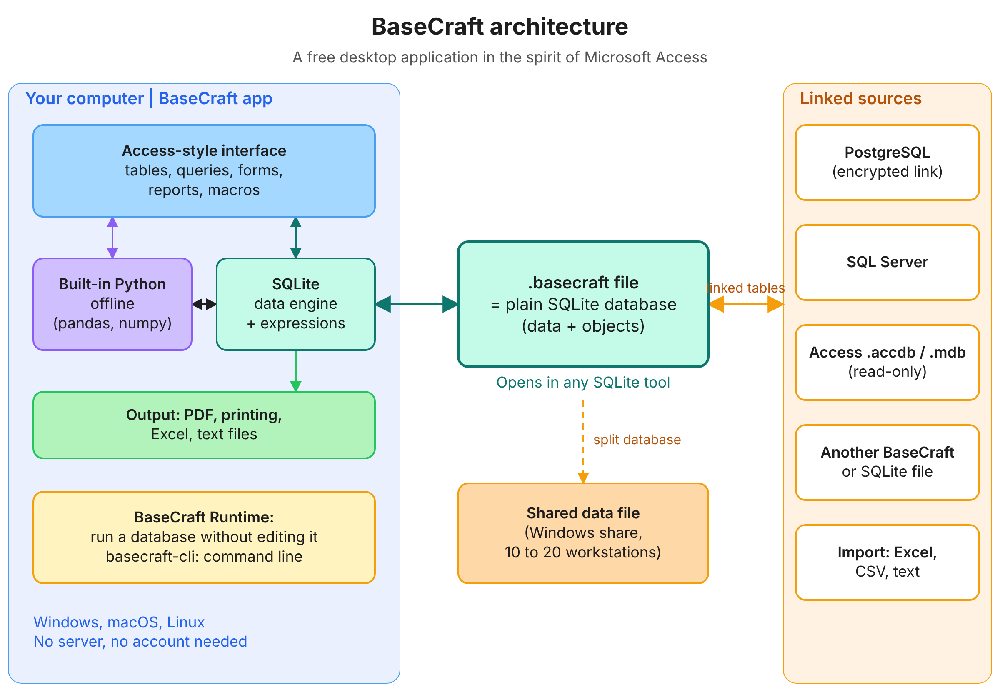

<p align="center"><a href="README.md">English</a> · <a href="docs/translations/README.fr.md">Français</a> · <a href="docs/translations/README.es.md">Español</a> · <a href="docs/translations/README.de.md">Deutsch</a> · <a href="docs/translations/README.it.md">Italiano</a> · <a href="docs/translations/README.pt.md">Português</a> · <a href="docs/translations/README.nl.md">Nederlands</a> · <a href="docs/translations/README.pl.md">Polski</a> · <a href="docs/translations/README.ja.md">日本語</a> · <a href="docs/translations/README.zh.md">简体中文</a> · <a href="docs/translations/README.ko.md">한국어</a></p>

<div align="center">



<h1>BaseCraft</h1>

<p><strong>The desktop database workbench; an open-source application in the spirit of Microsoft Access.</strong><br>
Build tables, queries, forms and reports in a single file that stays a plain SQLite database.<br>
Windows · macOS · Linux</p>

<p>
<a href="LICENSE"></a>


<br>
<a href="https://github.com/gdsolutions-dev/BaseCraft/actions/workflows/ci.yml"></a>
<a href="https://github.com/gdsolutions-dev/BaseCraft/releases"></a>
</p>

<p><a href="https://gdsolutions-dev.github.io/BaseCraft/"><strong>Website</strong></a> · <a href="https://github.com/gdsolutions-dev/BaseCraft/releases">Download</a> · <a href="https://gdsolutions-dev.github.io/BaseCraft/maquettes/">UI mockups</a></p>



</div>

BaseCraft brings back the Access way of building small data applications — tables, queries, forms, reports, macros and code — with a modern interface, and without being tied to Windows. Everything a database contains lives in **a single file**, which is a plain SQLite database that any SQLite tool can still open.

> **Status: early development.** Stages A to D are complete in preview 0.5.0, and stage F (last form and report design features) is under way: tab order, themes, images and charts are done. Expect breaking changes before 1.0.

## Screenshots

<table>
<tr><td align="center"><br><sub>Form with a subform</sub></td><td align="center"><br><sub>Report preview with grouping and subtotals</sub></td></tr>
<tr><td align="center"><br><sub>Report Design view and Property Sheet</sub></td><td align="center"><br><sub>Query Design</sub></td></tr>
<tr><td align="center"><br><sub>Relationships</sub></td><td align="center"><br><sub>Datasheet, sorted and filtered</sub></td></tr>
<tr><td align="center"><br><sub>Macro Designer and Action Catalog</sub></td></tr>
</table>

## Why

People who manage structured data on a desktop usually end up with:

- **Excel**, which is not built for form-based data entry or related data;
- **Access**, which does the job but only runs on Windows and is prone to file corruption when shared over a network.

The goal: a good Excel user, without writing code, builds a small data-entry application in an afternoon — related tables, an entry form, a filtered query, a printed PDF report — and sends it to a colleague.

## Principles

- **Familiar.** Same object families and concepts as Access: Design view and run view for every object, QBE query grid, Datasheet, property sheets.
- **Your data stays yours.** A `.basecraft` file is an ordinary SQLite database. User tables are real SQLite tables with the names you chose; BaseCraft never puts custom functions or collations in the schema.
- **Safe by default.** No data loss after a crash; a file received by email cannot harm your machine.
- **Nothing to install for solo use.** No server, no Python, no extra runtime.
- **Multilingual.** Interface in 11 languages (English, French, Spanish, German, Italian, Portuguese, Dutch, Polish, Japanese, Chinese, Korean); expressions are shown in French or English.

## Architecture

<p align="center"></p>

## What works today

- Create and open `.basecraft` files, with versioned format and migrations
- Write lock with heartbeat; a second machine opens the file read-only
- Detection of network shares and synced folders (OneDrive, Dropbox…)
- Tables: Design view (field types, keys, multi-field indexes, table validation rule, lossless changes), Table Fields tab from the Datasheet
- Datasheet: entry, sorting, filters, Find, deletion, per-row save
- Field properties: Format, Default Value, Validation Rule and Validation Text, Input Mask, Lookup fields
- Relationships window with referential integrity and cascades; Expression Builder
- Expression engine with Access semantics (parser, evaluator, SQLite generator)
- Queries: QBE grid and SQL view, Select, Group By, Parameter and action queries
- Forms: Design view, Property Sheet, controls, Single Form, Continuous Forms, Datasheet, master/detail subforms, AutoForm
- Reports: band designer, grouping and totals, Print Preview, PDF export and printing, AutoReport
- Import: text files (delimited and fixed width) and Excel; export: text files and Excel; Cut, Copy and Paste of objects
- Linked tables: link the tables of another BaseCraft file or a SQLite file, Linked Table Manager; a linked table opens in Design view read-only, after a warning (as in Access)
- Linked Access databases (`.accdb`, `.mdb`, password-protected ones too): link their tables read-only, refreshed when the file changes
- Split database: Database Tools › Split Database moves the tables to a shared data file; several workstations enter data in it at the same time, with Access's Write Conflict dialog and refresh interval (see [Split database and shared data file](#split-database-and-shared-data-file))
- PostgreSQL linked tables: External Data › PostgreSQL links server tables over TLS; datasheets, forms and queries on them run on the server, and two people editing the same record get the Write Conflict dialog (see [PostgreSQL linked tables](#postgresql-linked-tables))
- SQL Server linked tables: External Data › SQL Server links server tables (SQL login, encrypted connection, named instances) the same way (see [SQL Server linked tables](#sql-server-linked-tables))
- Move to a server: Database Tools › Move Data › To a Server moves every local table (structure, data, keys, indexes, relationships) to PostgreSQL or SQL Server after a backup copy, replaces them with linked tables that keep their captions, formats and rules, and shows a report; External Data › Import › PostgreSQL / SQL Server copies server tables into local ones (see [Move to a server](#move-to-a-server))
- Pass-through queries: Query Type › SQL direct sends a text in PostgreSQL's or SQL Server's own language to the server as typed, with a read-only result for datasheets, forms and reports or an action run with « Activer le contenu » (see [Pass-through queries](docs/postgresql.md#pass-through-queries))
- Python (Pyodide, offline, numpy and pandas included): modules, Immediate window (Ctrl+G), `msgbox` and `inputbox`, Ctrl+Break (see [Python](docs/python.md))
- Themes: six built-in themes with light and dark palettes, Themes, Colors and Fonts galleries (all matching objects, this object only, default), your own saved themes (see [Themes](docs/themes.md))
- Images: a shared image gallery stored in the database (PNG, JPEG, GIF, WebP, 1 MB), Insert Image with Browse, replace and delete, form and report background pictures (size mode, alignment, tiling), Image control alignment and tiling, command button pictures, `basecraft-cli resources` (see [Images](docs/images.md))
- Charts: Insert Modern Chart (Column, Bar, Line, Area, Pie, Radar, Combo, Doughnut, Arc, Scatter, Bubble, Box and Whisker, Funnel, Pareto, Waterfall; clustered, stacked, 100 % for the first four), Chart Settings, Link Master/Child, drawn in forms and printed in report PDFs in the theme's colours (see [Charts](docs/charts.md))
- Layouts and Layout view (Mode Page) for forms and reports: Stacked and Tabular layouts, merge and split, gridlines, margins, padding, anchoring, empty cells (see [Layout view](docs/layout-view.md))
- Save As, Compact and Repair; `.basecraft` file association
- Ribbon, navigation pane, tabs, light and dark themes
- File › Options: workstation settings (confirmations, recent databases, last database at startup, default folder) and database options (menus, shortcut menus, special keys, status bar, tabs, compact on close), plus Enter and arrow keys, datasheet gridlines, width and font, four-digit years and Find defaults, object designers' defaults (new field type and size, AutoIndex, AutoJoin, designer fonts, selection behavior) and default print margins, Name AutoCorrect (track, perform, and log renames) and the property update options

## Roadmap

| Stage | Content |
|---|---|
| **A — Replace Excel** ✅ | Tables, relations and expressions, queries (QBE + SQL), forms, reports with PDF export, CSV/Excel import and export, installers |
| **B — Automate and distribute** ✅ | Events, macros, AutoExec, BaseCraft Runtime (run a database without design access) |
| **C — Work together** ✅ | Linked tables on PostgreSQL, SQL Server, SQLite and Access; split database and shared data file with optimistic locking; pass-through queries; migration wizard to a server |
| **D — Python** ✅ | Python code (Pyodide) in place of VBA, with BaseCraft objects: modules, Immediate window, events, Python functions in expressions, Convert Macros to Python |
| **E — Access import** | Tables, data, queries, forms, reports and macros from `.mdb` / `.accdb` |
| **F — Last form and report features** 🚧 | Done: tab order, themes, images, charts (ECharts); next: the remaining design features |

Not planned: VBA compatibility, concurrent design by several people, a web or mobile version.

## Download

Preview builds for Windows, macOS and Linux are on the [Releases page](https://github.com/gdsolutions-dev/BaseCraft/releases). They are early previews: keep backups of important data.

- **Windows:** `BaseCraft-x.y.z-win-x64.exe` (installer) or `.zip` (portable). The builds are signed by SARL IN SET. As the certificate is new, Windows SmartScreen may still warn you for a while: choose *More info*, then *Run anyway*.
- **macOS (Apple silicon):** `BaseCraft-x.y.z-mac-arm64.dmg` or `.zip`. **Not tested on a Mac yet:** these builds are produced by CI but nobody has run them; please report any problem in the issues. They are not notarized either: after copying BaseCraft to Applications, run `xattr -dr com.apple.quarantine /Applications/BaseCraft.app` once, or macOS reports the app as damaged.
- **Linux:** `BaseCraft-x.y.z-linux-amd64.deb` (`sudo apt install ./BaseCraft-x.y.z-linux-amd64.deb`), `BaseCraft-x.y.z-linux-x86_64.AppImage` (make it executable, then run it) or `.tar.gz`.

### BaseCraft Runtime

BaseCraft Runtime runs a database without design access: no Design view, no design tools. You can give it to the people who only use your bases. It is a separate product with its own installer, `BaseCraft-Runtime-x.y.z-<os>-<arch>`, for Windows (`.exe` or `.zip`) and Linux (`.deb`, `.AppImage` or `.tar.gz`). The two products can be installed side by side.

- **Windows:** the full application keeps `.basecraft`: when both products are installed, a double-click opens the full application, whatever the install order, with one exception: if the Runtime was installed for the current user only and the full application for all users, the Runtime opens the file. BaseCraft Runtime is listed under *Open with* (« Ouvrir avec »). It opens `.basecraft` files on a double-click only when it is installed alone. If you uninstall the full application and keep the Runtime, Windows asks which application to use at the next double-click: choose BaseCraft Runtime.
- **Linux:** both products declare `application/x-basecraft`. The desktop chooses the default; to see it, or to change it, run `xdg-mime query default application/x-basecraft` or `xdg-mime default basecraft.desktop application/x-basecraft` (`basecraft-runtime.desktop` for the Runtime).
- **macOS:** no Runtime build yet. The macOS builds of the full application are not signed or notarized (see above).

#### Distributing a base with BaseCraft Runtime

1. **Prepare the base** in BaseCraft (the full application), under File › Options › Current Database: set **Application Title**, choose the form shown at opening in **Display Form**, and clear **Display Navigation Pane** if users should stay in your forms. A macro named `AutoExec` runs at each opening, after the startup form.
2. **Preview it** without the Runtime: tick **Open in run mode**, then close and reopen the base. Hold Shift while opening to bypass the startup options; BaseCraft Runtime has no such bypass.
3. **Install BaseCraft Runtime** on each workstation, from the [Releases page](https://github.com/gdsolutions-dev/BaseCraft/releases).
4. **Give the `.basecraft` file** to its users. They open it with a double-click when the Runtime is installed alone, with *Open with* otherwise.
5. **Macros and action queries:** each user clicks **Enable Content** once, or an administrator trusts the folder (see below).
6. **Several users:** split the base with **Split Database**, then put the data file and the front-end on a share. The Runtime opens the front-end from a local copy; replace the front-end on the share and each workstation takes the new version at its next opening.
7. **After updating BaseCraft:** open the base once with the full application. BaseCraft Runtime never upgrades a base's format and refuses a base that needs it.

BaseCraft Runtime prevents design changes; it does not protect the data. A `.basecraft` file remains an ordinary SQLite database and, unless the base hides it, the Navigation Pane lists every object.

### Macros, action queries and trusted folders

Macros and action queries in a base you open are disabled until you click **Enable Content** (« Activer le contenu ») in the security bar, or until the file is in a folder an administrator has trusted. Bases created before 0.3 that already hold saved action queries ask once.

Administrators list trusted folders in a system file that BaseCraft only reads:

- Windows: `%ProgramData%\BaseCraft\trust.json`
- macOS: `/Library/Application Support/BaseCraft/trust.json`
- Linux: `/etc/basecraft/trust.json`

```json
{ "trustedFolders": [{ "path": "D:\\Bases\\Compta", "subfolders": true }] }
```

Create the folder holding this file with write permission for administrators only, or any user could trust their own folders.

### Split database and shared data file

Database Tools › Split Database (« Fractionner la base de données ») moves the tables of a base to a data file (`<name>_donnees.basecraft`, or `<name>_data.basecraft` in English) and turns the base into a front-end that links to them; a backup of the original is made first. Put the data file on a shared folder, give every workstation the front-end, and several people enter data in the same tables at the same time:

- **Supported: Windows workstations on a Windows share only.** On the Windows server (or PC) that holds the data file, turn off opportunistic locks and leasing once, in PowerShell run as administrator, as for Access databases on a share:

  ```powershell
  Set-SmbServerConfiguration -EnableOplocks $false -EnableLeasing $false
  ```

  This support matrix comes from a concurrent-write spike run on one PC over a virtual network; the validation on two real machines is pending ([checklist](docs/superpowers/plans/2026-10-29-basecraft-c3-validation-manuelle.md)).

- **Not supported:** Samba shares (a NAS, a Linux server). Linux workstations (and macOS ones, while macOS is on hold) open a data file on a network share **read-only**: their SMB client cannot take SQLite's write lock.
- **Size:** 10 to 20 workstations on a local network. Every workstation must run a BaseCraft release that has the shared data file, or a later one: an older release does not know the shared mode and gets no write-conflict check.
- **Paths:** use UNC paths (`\\server\share\Ventes_donnees.basecraft`) rather than mapped drive letters, which differ from one PC to another.
- **No synchronized folder** (OneDrive, Dropbox, Google Drive…): sync tools copy half-written files, so a data file there opens read-only.
- **Structure changes** (a new field, a relation, Compact and Repair) need the data file to yourself: open the data file itself, not a front-end; while others are connected, BaseCraft names them and refuses the change. Entering data, forms, queries and reports work while others are connected.
- **Record locking:** « Aucun » (no locks), as Access's default: when two people change the same record, the second save shows the Write Conflict dialog (Save Record, Copy to Clipboard, Drop Changes). Workstation options (File › Options › Client Settings › Advanced): default open mode, refresh interval (60 s by default), number of update retries and update retry interval.
- **One front-end per workstation with the full application.** BaseCraft (the full application) opens a front-end in place, with its exclusive lock: give each workstation its own copy of the front-end (on its own disk, or its own file on the share). Two people who open the same front-end file with the full application get it the way any base works: the second one reads only, its links to the data file included.
- **BaseCraft Runtime** opens a front-end from a share through a local copy (in its user data folder), copied again when the original changes: only the Runtime does this copy for you. Republish the front-end on the share and each workstation takes the new version at its next opening.

### PostgreSQL linked tables

External Data › PostgreSQL (« Données externes › PostgreSQL ») links the tables of a PostgreSQL server, as Access links ODBC tables. Datasheets, forms and queries on them run on the server, and the server checks and stores every write. When two people change the same record, the second save shows the Write Conflict dialog. The full reference (types, the functions a query can use on a server, the differences from Access) is in [docs/postgresql.md](docs/postgresql.md).

- **Requirements:** PostgreSQL 14 or later; a login with `SELECT`, `INSERT`, `UPDATE` and `DELETE` on the linked tables; a primary key on each table you want to edit (a view or a table without one opens read-only).
- **TLS:** « Chiffré, certificat vérifié » (the default) needs the server's certificate to be trusted by the workstation: install the certificate of its authority in the system's store. « Chiffré, sans vérifier le certificat » encrypts without checking it. « Non chiffré » is for a trusted network only.
- **Passwords:** each user logs in with their own PostgreSQL login. The password is never written into the front-end. With « Mémoriser le mot de passe sur ce poste » (ticked by default), it is encrypted with the operating system's protection (safeStorage: Windows: your account's DPAPI; Linux: the desktop's keyring) and kept in `credentials.json` in BaseCraft's user data folder. A remembered password is tied to the link's TLS mode: after a change of mode, it is asked once more.
- **Linux without a keyring** (no GNOME Keyring or KWallet, as on a minimal install): BaseCraft never stores the password in a weaker form. « Mémoriser » is disabled, with an explanation, and the password is asked at each session.
- **What runs on a server:** datasheets, forms and queries on one or several joined server tables, including data entry through a query on several tables (orders joined to their customers: one server transaction, all or nothing). Action queries (Append, Update, Delete: one server transaction) and crosstab queries run on the server too; Make-Table queries do not. A function BaseCraft cannot translate for PostgreSQL (`Format`, for example) is refused with a message that names it, and the query is not sent. A query cannot mix local tables and server tables.
- **Case and accents:** text comparisons ignore case, as in Access. On a server whose character classification (`LC_CTYPE`) is `C`, accented capitals such as `É` are not folded: there, « ÉTÉ » and « été » differ. A server created with a UTF-8 locale or an ICU collation folds them.
- **One front-end per workstation:** give each workstation its own copy of the front-end, as for a split database.

### SQL Server linked tables

External Data › SQL Server (« Données externes › SQL Server ») links the tables of a SQL Server database as PostgreSQL's do: queries run on the server and the server checks and stores every write. The full reference (types, collations, the functions a query can use, locking, pass-through queries, limits) is in [docs/sqlserver.md](docs/sqlserver.md).

- **Requirements:** SQL Server 2016 or later, Azure SQL Database or Managed Instance; a SQL Server login (Windows and Microsoft Entra authentication are not supported) with `SELECT`, `INSERT`, `UPDATE` and `DELETE` on the linked tables; a primary key on each table you want to edit (a view or a table without one opens read-only).
- **Encryption:** « Chiffré, certificat vérifié » (the default) needs the server's certificate to be trusted by the workstation. « Chiffré, approuver le certificat du serveur » encrypts without checking it (SQL Server's self-signed certificate). « Non chiffré » is for a trusted network only.
- **Named instances:** type `host\instance` (for example `serveur\SQLEXPRESS`) in « Serveur »; the port is then found through the SQL Server Browser service (UDP 1434).
- **Passwords:** as for PostgreSQL: each user logs in with their own login; the password is never written into the front-end; « Mémoriser » keeps it encrypted with the operating system's protection, and never on Linux without a keyring.
- **Conflicts:** a table with a `rowversion` column is checked on it; one without is checked on the values read (except `float`, `real` and long text columns), as Access does.

### Move to a server

Database Tools › Move Data › To a Server (Move to Server Wizard) moves an application's tables to PostgreSQL or SQL Server, as Access's Upsizing Wizard does. The full guide (what moves, the type table, what stays in the front-end, the safety rules, the report, the limits) is in [docs/server-migration.md](docs/server-migration.md).

- **What moves:** every local table, with its data, primary key, required fields, literal defaults, indexes and enforced relationships (cascades included; on SQL Server, a cascade that would give a table two paths is created without cascade and the report says so). AutoNumbers continue after the largest number ever given. SQL Server tables get a `bc_rowversion` column for exact conflict checks.
- **Safety:** a backup copy of the base is made first; the server side is one transaction, so a failure, a lost connection or Stop leaves nothing on the server; then every local table is replaced by its link in one local transaction, or none is.
- **What stays in the front-end:** validation rules, expression defaults and Allow Zero Length are checked by BaseCraft on every write, not by the server: other programs writing to the tables bypass them. Queries, forms, reports and macros stay in the front-end; the report lists the queries the server cannot run.
- **Afterwards:** the base is a front-end (« Application frontale »): give it to the workstations, where BaseCraft Runtime opens it from a local copy, and several people enter data at the same time with the Write Conflict dialog.
- **Import:** External Data › Import › PostgreSQL / SQL Server copies server tables into new local tables (data, types and key; not the other indexes).

### Reading a `.basecraft` file from Power Query

A `.basecraft` file is an ordinary SQLite database, so Excel and Power BI can read its tables through an ODBC driver. Power Query has no built-in SQLite connector.

1. Install a SQLite ODBC driver (for example the [SQLite ODBC Driver](http://www.ch-werner.de/sqliteodbc/)), in the same bitness (32 or 64 bit) as Excel or Power BI.
2. In Power Query, open the Advanced Editor and use:

```m
let
    // Path of the SQLite file
    Path = "file.basecraft",

    // Connection string (driver name exactly as listed in the ODBC administrator)
    Connection = "Driver={SQLite3 ODBC Driver};Database=" & Path & ";",

    // Source: navigator of tables and views
    Source = Odbc.DataSource(Connection, [HierarchicalNavigation = true])
in
    Source
```

- Use the full path of the file, and add `ReadOnly=1;` to the connection string if BaseCraft has the file open.
- SQLite stores dates as text or numbers: convert the columns in Power Query.
- Power BI Service needs an on-premises data gateway with the driver installed.

## Build from source

Requirements: [Node.js](https://nodejs.org/) 24 or later (BaseCraft uses the built-in `node:sqlite`).

```sh
npm install
npm run dev        # start the app in development mode
npm test           # unit tests (Vitest)
npm run typecheck  # TypeScript checks
npm run e2e        # end-to-end tests (Playwright + Electron)
npm run dist:win   # Windows installer and zip, in dist/ (run on Windows)
npm run dist:linux # Linux .deb, AppImage and tar.gz, in dist/ (run on Linux)
npm run dist:mac   # macOS dmg and zip (arm64), in dist/ (run on macOS)
npm run dist:runtime:win   # BaseCraft Runtime installer and zip, in dist-runtime/ (run on Windows)
npm run dist:runtime:linux # BaseCraft Runtime .deb, AppImage and tar.gz, in dist-runtime/ (run on Linux)
```

Stack: Electron, React, TypeScript, Vite, Glide Data Grid, SQLite.

## Documentation

- [UI mockups](https://gdsolutions-dev.github.io/BaseCraft/maquettes/)
- [PostgreSQL linked tables](docs/postgresql.md)
- [SQL Server linked tables](docs/sqlserver.md)
- [Move an application to a server](docs/server-migration.md)

## License

[GNU Affero General Public License v3.0](LICENSE).

Microsoft Access is a trademark of Microsoft Corporation. BaseCraft is an independent project, not affiliated with or endorsed by Microsoft.
