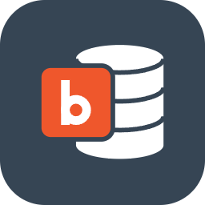
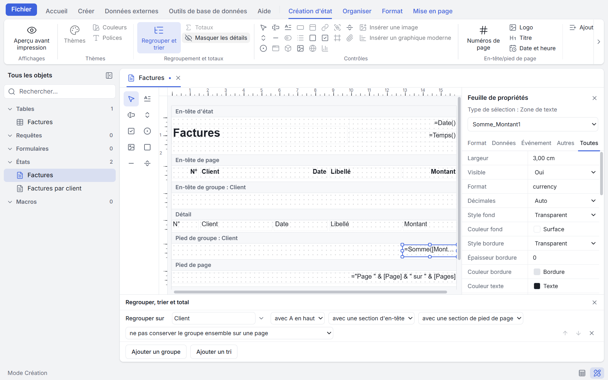

<p align="center"><a href="../../README.md">English</a> · <a href="README.fr.md">Français</a> · <a href="README.es.md">Español</a> · <a href="README.de.md">Deutsch</a> · <a href="README.it.md">Italiano</a> · <a href="README.pt.md">Português</a> · <a href="README.nl.md">Nederlands</a> · <a href="README.pl.md">Polski</a> · <a href="README.ja.md">日本語</a> · <a href="README.zh.md">简体中文</a> · <a href="README.ko.md">한국어</a></p>

<div align="center">



<h1>BaseCraft</h1>

<p><strong>L'atelier de bases de données de bureau ; une application open source dans l'esprit de Microsoft Access.</strong><br>
Créez tables, requêtes, formulaires et états dans un seul fichier qui reste une simple base SQLite.<br>
Windows · macOS · Linux</p>

<p>
<a href="../../LICENSE"></a>


<br>
<a href="https://github.com/gdsolutions-dev/BaseCraft/actions/workflows/ci.yml"></a>
<a href="https://github.com/gdsolutions-dev/BaseCraft/releases"></a>
</p>

<p><a href="https://gdsolutions-dev.github.io/BaseCraft/"><strong>Site web</strong></a> · <a href="https://github.com/gdsolutions-dev/BaseCraft/releases">Télécharger</a> · <a href="https://gdsolutions-dev.github.io/BaseCraft/maquettes/">Maquettes de l'interface</a></p>



</div>

BaseCraft retrouve la manière Access de construire de petites applications de données — tables, requêtes, formulaires, états, macros et code — avec une interface moderne, sans être lié à Windows. Tout ce qu'une base contient vit dans **un seul fichier**, une simple base SQLite que n'importe quel outil SQLite peut encore ouvrir.

> **État : développement précoce.** L'étape A (tables, relations, requêtes, formulaires, états, import et export) est terminée dans la préversion 0.2.0. Attendez-vous à des changements incompatibles avant la 1.0.

## Pourquoi

Les personnes qui gèrent des données structurées sur un poste de bureau finissent généralement avec :

- **Excel**, qui n'est pas conçu pour la saisie par formulaire ni pour les données liées ;
- **Access**, qui fait le travail mais ne fonctionne que sous Windows et risque la corruption du fichier lorsqu'il est partagé sur un réseau.

L'objectif : un bon utilisateur d'Excel, sans écrire de code, construit en un après-midi une petite application de saisie — tables liées, formulaire de saisie, requête filtrée, état PDF imprimé — et l'envoie à un collègue.

## Principes

- **Familier.** Les mêmes familles d'objets et les mêmes concepts qu'Access : mode Création et mode exécution pour chaque objet, grille de requête QBE, Feuille de données, feuilles de propriétés.
- **Vos données restent à vous.** Un fichier `.basecraft` est une base SQLite ordinaire. Les tables utilisateur sont de vraies tables SQLite portant les noms que vous avez choisis ; BaseCraft n'ajoute jamais de fonctions ni de collations personnalisées dans le schéma.
- **Sûr par défaut.** Aucune perte de données après un plantage ; un fichier reçu par e-mail ne peut pas nuire à votre machine.
- **Rien à installer pour un usage individuel.** Pas de serveur, pas de Python, pas d'environnement d'exécution supplémentaire.
- **Bilingue.** Interface en anglais et en français, y compris les expressions affichées dans la langue de l'interface.

## Ce qui fonctionne aujourd'hui

- Création et ouverture de fichiers `.basecraft`, avec format versionné et migrations
- Verrou d'écriture avec battement de cœur ; une seconde machine ouvre le fichier en lecture seule
- Détection des partages réseau et des dossiers synchronisés (OneDrive, Dropbox…)
- Tables : mode Création (types de champ, clés, index multichamps, règle de validation de table, modifications sans perte), onglet Champs de la table depuis la Feuille de données
- Feuille de données : saisie, tri, filtres, Rechercher, suppression, enregistrement par ligne
- Propriétés de champ : Format, Valeur par défaut, Règle de validation et Message si erreur, Masque de saisie, champs de liste de choix
- Fenêtre Relations avec intégrité référentielle et cascades ; Générateur d'expressions
- Moteur d'expressions à la sémantique Access (analyseur, évaluateur, générateur SQLite)
- Requêtes : grille QBE et mode SQL, requêtes Sélection, Regroupement, Paramètres et Action
- Formulaires : mode Création, Feuille de propriétés, contrôles, Formulaire simple, Formulaires continus, Feuille de données, sous-formulaires maître/détail, Formulaire automatique
- États : concepteur par sections, regroupements et totaux, Aperçu avant impression, export PDF et impression, État automatique
- Import : fichiers texte (délimités et à largeur fixe) et Excel ; export : fichiers texte et Excel ; Couper, Copier et Coller des objets
- Tables liées : lier les tables d'un autre fichier BaseCraft ou d'un fichier SQLite, Gestionnaire de tables liées
- Enregistrer sous, Compacter et réparer ; association du type de fichier `.basecraft`
- Ruban, volet de navigation, onglets, thèmes clair et sombre
- Fichier › Options : paramètres du poste de travail (confirmations, bases récentes, dernière base au démarrage, dossier par défaut) et options de la base (menus, menus contextuels, touches spéciales, barre d'état, onglets, compactage à la fermeture)

## Feuille de route

| Étape | Contenu |
|---|---|
| **A — Remplacer Excel** ✅ | Tables, relations et expressions, requêtes (QBE + SQL), formulaires, états avec export PDF, import et export CSV/Excel, programmes d'installation |
| **B — Automatiser et distribuer** | Événements, macros, AutoExec, BaseCraft Runtime (exécuter une base sans accès à la conception) |
| **C — Travailler ensemble** | Tables liées vers PostgreSQL, SQL Server, SQLite et Access ; verrouillage optimiste ; assistant de migration |
| **D — Python** | Code Python (Pyodide) à la place de VBA, avec les objets BaseCraft |
| **E — Import Access** | Tables, données, requêtes, formulaires, états et macros depuis `.mdb` / `.accdb` |

Non prévus : la compatibilité VBA, la conception simultanée par plusieurs personnes, une version web ou mobile.

## Téléchargement

Les versions préliminaires pour Windows, macOS et Linux sont sur la [page des Releases](https://github.com/gdsolutions-dev/BaseCraft/releases). Ce sont de premières préversions : conservez des sauvegardes de vos données importantes.

- **Windows :** `BaseCraft-x.y.z-win-x64.exe` (programme d'installation) ou `.zip` (portable). Les versions sont signées par SARL IN SET. Le certificat étant récent, Windows SmartScreen peut encore vous avertir pendant un certain temps : choisissez *Informations complémentaires*, puis *Exécuter quand même*.
- **macOS (Apple silicon) :** `BaseCraft-x.y.z-mac-arm64.dmg` ou `.zip`. **Pas encore testé sur un Mac :** ces versions sont produites par l'intégration continue mais personne ne les a exécutées ; merci de signaler tout problème dans les issues. Elles ne sont pas non plus notarisées : après avoir copié BaseCraft dans Applications, exécutez une fois `xattr -dr com.apple.quarantine /Applications/BaseCraft.app`, sinon macOS signale l'application comme endommagée.
- **Linux :** `BaseCraft-x.y.z-linux-amd64.deb` (`sudo apt install ./BaseCraft-x.y.z-linux-amd64.deb`), `BaseCraft-x.y.z-linux-x86_64.AppImage` (rendez-le exécutable, puis lancez-le) ou `.tar.gz`.

### BaseCraft Runtime

BaseCraft Runtime exécute une base sans accès à la conception : pas de mode Création, pas d'outils de conception. Vous pouvez le donner aux personnes qui ne font qu'utiliser vos bases. C'est un produit distinct, avec son propre programme d'installation, `BaseCraft-Runtime-x.y.z-<os>-<arch>`, pour Windows (`.exe` ou `.zip`) et Linux (`.deb`, `.AppImage` ou `.tar.gz`). Les deux produits peuvent être installés côte à côte.

- **Windows :** l'application complète conserve `.basecraft` : lorsque les deux produits sont installés, un double-clic ouvre l'application complète, quel que soit l'ordre d'installation, avec une exception : si le Runtime a été installé pour l'utilisateur courant seulement et l'application complète pour tous les utilisateurs, c'est le Runtime qui ouvre le fichier. BaseCraft Runtime figure sous *Ouvrir avec* (« Ouvrir avec »). Il n'ouvre les fichiers `.basecraft` par double-clic que s'il est installé seul. Si vous désinstallez l'application complète et gardez le Runtime, Windows demande quelle application utiliser au prochain double-clic : choisissez BaseCraft Runtime.
- **Linux :** les deux produits déclarent `application/x-basecraft`. C'est l'environnement de bureau qui choisit le défaut ; pour le voir ou le modifier, exécutez `xdg-mime query default application/x-basecraft` ou `xdg-mime default basecraft.desktop application/x-basecraft` (`basecraft-runtime.desktop` pour le Runtime).
- **macOS :** pas encore de version Runtime. Les versions macOS de l'application complète ne sont ni signées ni notarisées (voir plus haut).

### Macros, requêtes Action et dossiers approuvés

Les macros et les requêtes Action d'une base que vous ouvrez sont désactivées tant que vous n'avez pas cliqué sur **Activer le contenu** (« Activer le contenu ») dans la barre de sécurité, ou que le fichier ne se trouve pas dans un dossier qu'un administrateur a approuvé. Les bases créées avant la 0.3 qui contiennent déjà des requêtes Action enregistrées demandent une fois.

Les administrateurs listent les dossiers approuvés dans un fichier système que BaseCraft ne fait que lire :

- Windows : `%ProgramData%\BaseCraft\trust.json`
- macOS : `/Library/Application Support/BaseCraft/trust.json`
- Linux : `/etc/basecraft/trust.json`

```json
{ "trustedFolders": [{ "path": "D:\\Bases\\Compta", "subfolders": true }] }
```

Créez le dossier contenant ce fichier avec un droit d'écriture réservé aux administrateurs, sinon n'importe quel utilisateur pourrait approuver ses propres dossiers.

## Compiler depuis les sources

Prérequis : [Node.js](https://nodejs.org/) 24 ou supérieur (BaseCraft utilise le module intégré `node:sqlite`).

```sh
npm install
npm run dev        # start the app in development mode
npm test           # unit tests (Vitest)
npm run typecheck  # TypeScript checks
npm run e2e        # end-to-end tests (Playwright + Electron)
npm run dist:win   # Windows installer and zip, in dist/ (run on Windows)
npm run dist:linux # Linux .deb, AppImage and tar.gz, in dist/ (run on Linux)
npm run dist:mac   # macOS dmg and zip (arm64), in dist/ (run on macOS)
npm run dist:runtime:win   # BaseCraft Runtime installer and zip, in dist-runtime/ (run on Windows)
npm run dist:runtime:linux # BaseCraft Runtime .deb, AppImage and tar.gz, in dist-runtime/ (run on Linux)
```

Pile technique : Electron, React, TypeScript, Vite, Glide Data Grid, SQLite.

## Documentation

- [Maquettes de l'interface](https://gdsolutions-dev.github.io/BaseCraft/maquettes/)

## Licence

[GNU Affero General Public License v3.0](../../LICENSE).

Microsoft Access est une marque de Microsoft Corporation. BaseCraft est un projet indépendant, non affilié à Microsoft ni approuvé par celle-ci.
