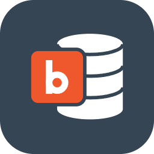
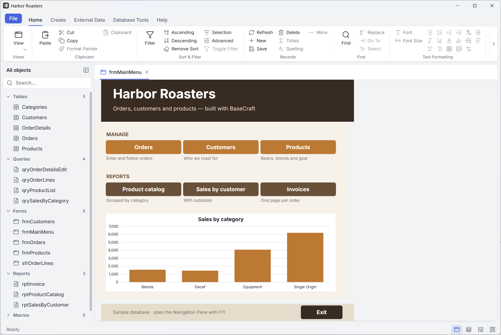
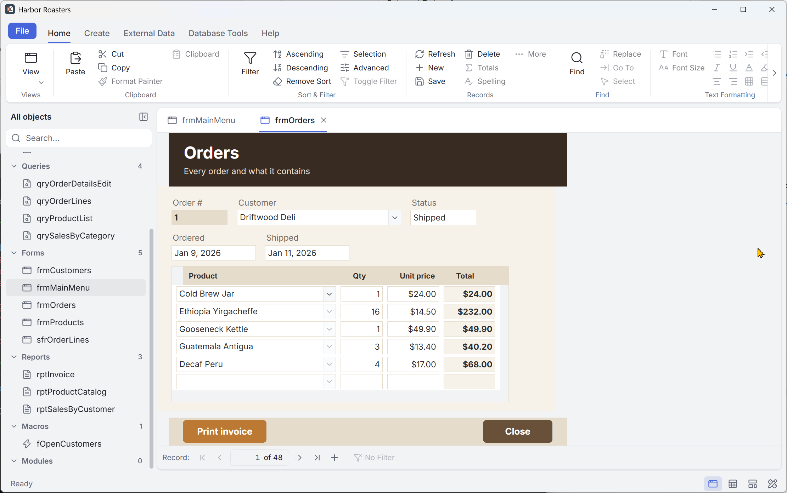
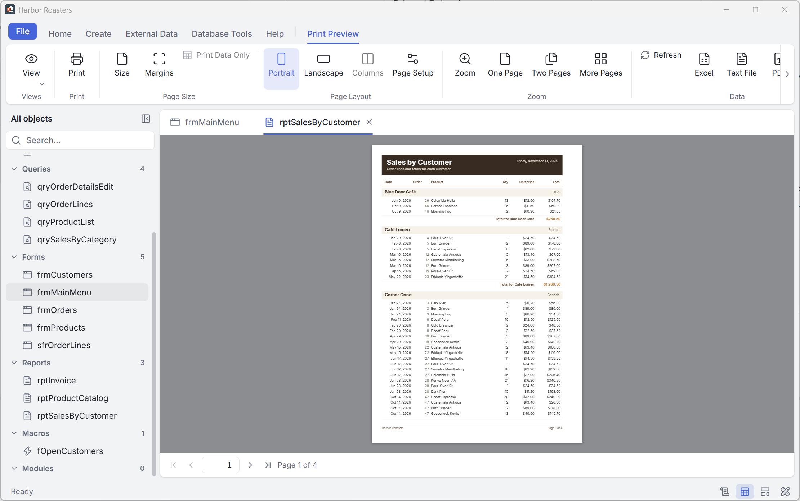
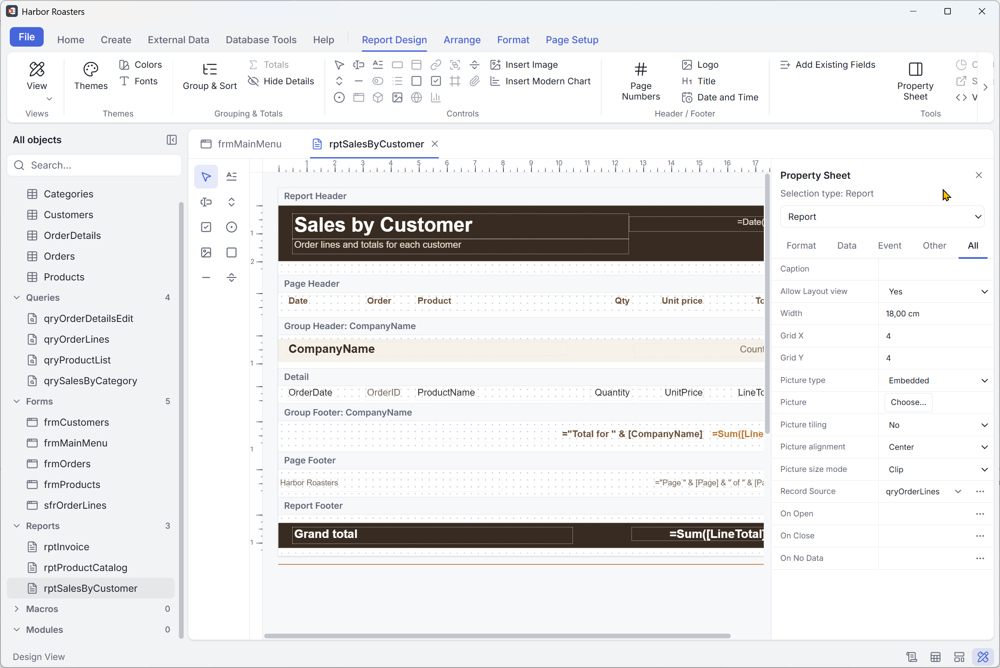
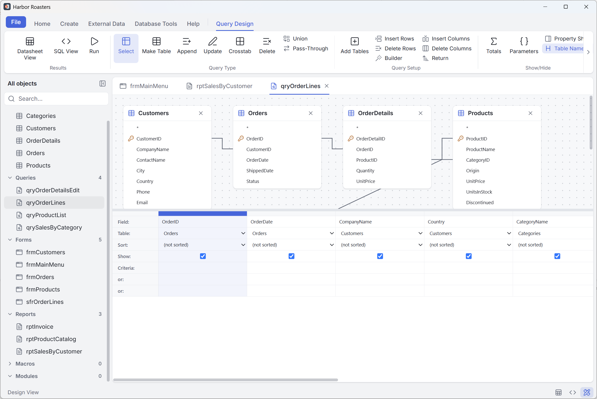
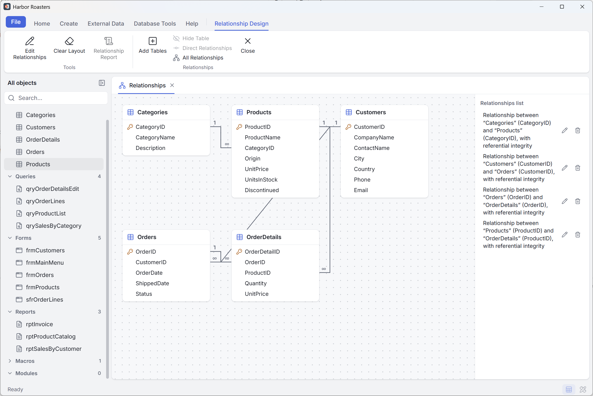
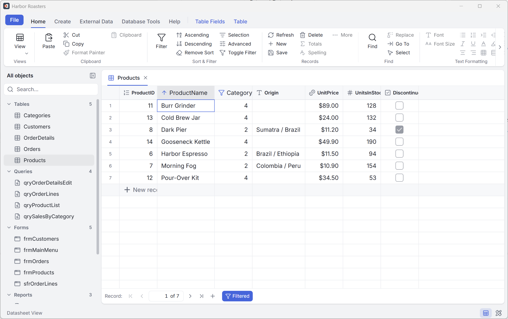
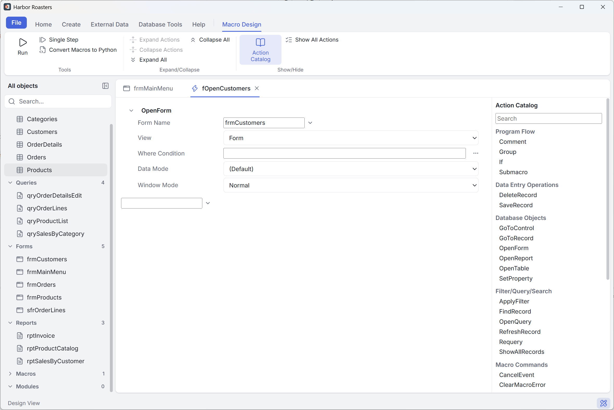

<p align="center"><a href="../../README.md">English</a> · <a href="README.fr.md">Français</a> · <a href="README.es.md">Español</a> · <a href="README.de.md">Deutsch</a> · <a href="README.it.md">Italiano</a> · <a href="README.pt.md">Português</a> · <a href="README.nl.md">Nederlands</a> · <a href="README.pl.md">Polski</a> · <a href="README.ja.md">日本語</a> · <a href="README.zh.md">简体中文</a> · <a href="README.ko.md">한국어</a></p>

<div align="center">



<h1>BaseCraft</h1>

<p><strong>De desktop-databasewerkbank; een opensourcetoepassing in de geest van Microsoft Access.</strong><br>
Bouw tabellen, query's, formulieren en rapporten in één bestand dat gewoon een SQLite-database blijft.<br>
Windows · macOS · Linux</p>

<p>
<a href="../../LICENSE"></a>


<br>
<a href="https://github.com/gdsolutions-dev/BaseCraft/actions/workflows/ci.yml"></a>
<a href="https://github.com/gdsolutions-dev/BaseCraft/releases"></a>
</p>

<p><a href="https://gdsolutions-dev.github.io/BaseCraft/"><strong>Website</strong></a> · <a href="https://github.com/gdsolutions-dev/BaseCraft/releases">Downloaden</a> · <a href="https://gdsolutions-dev.github.io/BaseCraft/maquettes/">UI-mockups</a></p>



</div>

BaseCraft brengt de Access-manier van kleine gegevenstoepassingen bouwen terug — tabellen, query's, formulieren, rapporten, macro's en code — met een moderne interface en zonder aan Windows gebonden te zijn. Alles wat een database bevat, staat in **één bestand**, een gewone SQLite-database die elk SQLite-hulpmiddel nog kan openen.

> **Status: vroege ontwikkeling.** Fase A tot en met D zijn voltooid in preview 0.5.0, en fase F (laatste ontwerpfuncties voor formulieren en rapporten) is bezig: tabvolgorde, thema's, afbeeldingen en grafieken zijn klaar. Verwacht brekende wijzigingen vóór 1.0.

## Schermafbeeldingen

<table>
<tr><td align="center"><br><sub>Formulier met subformulier</sub></td><td align="center"><br><sub>Rapportvoorbeeld met groepering en subtotalen</sub></td></tr>
<tr><td align="center"><br><sub>Ontwerpweergave van een rapport met eigenschappenvenster</sub></td><td align="center"><br><sub>Queryontwerp</sub></td></tr>
<tr><td align="center"><br><sub>Relaties</sub></td><td align="center"><br><sub>Gegevensblad, gesorteerd en gefilterd</sub></td></tr>
<tr><td align="center"><br><sub>Macro-ontwerper en actiecatalogus</sub></td></tr>
</table>

## Waarom

Wie op een desktop gestructureerde gegevens beheert, belandt meestal bij:

- **Excel**, dat niet is gemaakt voor invoer via formulieren of voor gerelateerde gegevens;
- **Access**, dat het werk doet maar alleen op Windows draait en bij delen via een netwerk gevoelig is voor bestandscorruptie.

Het doel: een goede Excel-gebruiker bouwt zonder code te schrijven in een middag een kleine toepassing voor gegevensinvoer — gerelateerde tabellen, een invoerformulier, een gefilterde query, een afgedrukt pdf-rapport — en stuurt die naar een collega.

## Principes

- **Vertrouwd.** Dezelfde objectfamilies en concepten als Access: ontwerpweergave en uitvoerweergave voor elk object, QBE-queryraster, gegevensblad, eigenschappenbladen.
- **Uw gegevens blijven van u.** Een `.basecraft`-bestand is een gewone SQLite-database. Gebruikerstabellen zijn echte SQLite-tabellen met de namen die u koos; BaseCraft zet nooit eigen functies of collaties in het schema.
- **Standaard veilig.** Geen gegevensverlies na een crash; een per e-mail ontvangen bestand kan uw computer niet schaden.
- **Niets te installeren voor solo-gebruik.** Geen server, geen Python, geen extra runtime.
- **Meertalig.** Interface in 11 talen (Engels, Frans, Spaans, Duits, Italiaans, Portugees, Nederlands, Pools, Japans, Chinees, Koreaans); expressies worden in het Frans of Engels weergegeven.

## Wat vandaag werkt

- `.basecraft`-bestanden maken en openen, met versiebeheer van het formaat en migraties
- Schrijfvergrendeling met heartbeat; een tweede computer opent het bestand alleen-lezen
- Detectie van netwerkshares en gesynchroniseerde mappen (OneDrive, Dropbox…)
- Tabellen: ontwerpweergave (veldtypen, sleutels, indexen over meerdere velden, validatieregel voor de tabel, verliesvrije wijzigingen), tabblad Tabelvelden vanuit het gegevensblad
- Gegevensblad: invoer, sorteren, filters, Zoeken, verwijderen, opslaan per rij
- Veldeigenschappen: Notatie, Standaardwaarde, Validatieregel en Validatietekst, Invoermasker, Opzoekvelden
- Relatievenster met referentiële integriteit en cascades; Expressiebouwer
- Expressie-engine met Access-semantiek (parser, evaluator, SQLite-generator)
- Query's: QBE-raster en SQL-weergave, selectie-, groeperings-, parameter- en actiequery's
- Formulieren: ontwerpweergave, eigenschappenblad, besturingselementen, enkel formulier, doorlopende formulieren, gegevensblad, hoofd-/detailsubformulieren, AutoFormulier
- Rapporten: banden-ontwerper, groepering en totalen, afdrukvoorbeeld, pdf-export en afdrukken, AutoRapport
- Import: tekstbestanden (gescheiden en met vaste breedte) en Excel; export: tekstbestanden en Excel; objecten knippen, kopiëren en plakken
- Gekoppelde tabellen: koppel de tabellen van een ander BaseCraft-bestand of een SQLite-bestand, Beheer gekoppelde tabellen
- Opslaan als, Comprimeren en herstellen; bestandskoppeling voor `.basecraft`
- Lint, navigatiedeelvenster, tabbladen, lichte en donkere thema's
- Bestand › Opties: instellingen per werkplek (bevestigingen, recente databases, laatste database bij het opstarten, standaardmap) en database-opties (menu's, snelmenu's, speciale toetsen, statusbalk, tabbladen, comprimeren bij afsluiten), plus de Enter- en pijltoetsen, rasterlijnen, breedte en lettertype van gegevensbladen, jaartallen met vier cijfers en de standaardwaarden van Zoeken, de standaardwaarden van de objectontwerpers (type en grootte van nieuwe velden, AutoIndex, AutoJoin, lettertypen van de ontwerpers, selectiegedrag) en de standaard afdrukmarges, automatische naamcorrectie (bijhouden, uitvoeren en loggen van naamswijzigingen) en de opties voor het bijwerken van eigenschappen

## Roadmap

| Fase | Inhoud |
|---|---|
| **A — Excel vervangen** ✅ | Tabellen, relaties en expressies, query's (QBE + SQL), formulieren, rapporten met pdf-export, csv-/Excel-import en -export, installatieprogramma's |
| **B — Automatiseren en verspreiden** ✅ | Gebeurtenissen, macro's, AutoExec, BaseCraft Runtime (een database uitvoeren zonder ontwerptoegang) |
| **C — Samenwerken** ✅ | Gekoppelde tabellen op PostgreSQL, SQL Server, SQLite en Access; gesplitste database en gedeeld gegevensbestand met optimistische vergrendeling; pass-through-query's; migratiewizard naar een server |
| **D — Python** ✅ | Python-code (Pyodide) in plaats van VBA, met BaseCraft-objecten: modules, Direct-venster, gebeurtenissen, Python-functies in expressies, macro's omzetten naar Python |
| **E — Access-import** | Tabellen, gegevens, query's, formulieren, rapporten en macro's uit `.mdb` / `.accdb` |
| **F — Laatste functies voor formulieren en rapporten** 🚧 | Klaar: tabvolgorde, thema's, afbeeldingen, grafieken (ECharts); daarna: de overige ontwerpfuncties |

Niet gepland: VBA-compatibiliteit, gelijktijdig ontwerpen door meerdere personen, een web- of mobiele versie.

## Downloaden

Previewversies voor Windows, macOS en Linux staan op de [Releases-pagina](https://github.com/gdsolutions-dev/BaseCraft/releases). Het zijn vroege previews: bewaar back-ups van belangrijke gegevens.

- **Windows:** `BaseCraft-x.y.z-win-x64.exe` (installatieprogramma) of `.zip` (portable). De builds zijn ondertekend door SARL IN SET. Omdat het certificaat nieuw is, kan Windows SmartScreen nog een tijd waarschuwen: kies *Meer info* en daarna *Toch uitvoeren*.
- **macOS (Apple silicon):** `BaseCraft-x.y.z-mac-arm64.dmg` of `.zip`. **Nog niet getest op een Mac:** deze builds worden door CI geproduceerd, maar niemand heeft ze uitgevoerd; meld problemen via de issues. Ze zijn ook niet genotariseerd: voer na het kopiëren van BaseCraft naar Programma's eenmalig `xattr -dr com.apple.quarantine /Applications/BaseCraft.app` uit, anders meldt macOS dat de app beschadigd is.
- **Linux:** `BaseCraft-x.y.z-linux-amd64.deb` (`sudo apt install ./BaseCraft-x.y.z-linux-amd64.deb`), `BaseCraft-x.y.z-linux-x86_64.AppImage` (uitvoerbaar maken en dan starten) of `.tar.gz`.

### BaseCraft Runtime

BaseCraft Runtime voert een database uit zonder ontwerptoegang: geen ontwerpweergave, geen ontwerphulpmiddelen. U kunt het geven aan mensen die uw databases alleen gebruiken. Het is een apart product met een eigen installatieprogramma, `BaseCraft-Runtime-x.y.z-<os>-<arch>`, voor Windows (`.exe` of `.zip`) en Linux (`.deb`, `.AppImage` of `.tar.gz`). De twee producten kunnen naast elkaar worden geïnstalleerd.

- **Windows:** de volledige toepassing behoudt `.basecraft`: als beide producten zijn geïnstalleerd, opent een dubbelklik de volledige toepassing, ongeacht de installatievolgorde, met één uitzondering: als de Runtime alleen voor de huidige gebruiker is geïnstalleerd en de volledige toepassing voor alle gebruikers, opent de Runtime het bestand. BaseCraft Runtime staat onder *Openen met* (« Ouvrir avec »). Het opent `.basecraft`-bestanden alleen met een dubbelklik als het alleen is geïnstalleerd. Als u de volledige toepassing verwijdert en de Runtime behoudt, vraagt Windows bij de volgende dubbelklik welke toepassing moet worden gebruikt: kies BaseCraft Runtime.
- **Linux:** beide producten declareren `application/x-basecraft`. De desktop kiest de standaard; voer `xdg-mime query default application/x-basecraft` uit om die te zien, of `xdg-mime default basecraft.desktop application/x-basecraft` om die te wijzigen (`basecraft-runtime.desktop` voor de Runtime).
- **macOS:** nog geen Runtime-build. De macOS-builds van de volledige toepassing zijn niet ondertekend of genotariseerd (zie hierboven).

#### Een database verspreiden met BaseCraft Runtime

1. **Bereid de database voor** in BaseCraft (de volledige toepassing), onder Bestand › Opties › Huidige database: stel de **Toepassingstitel** in, kies bij **Formulier weergeven** het formulier dat bij het openen verschijnt en schakel **Navigatiedeelvenster weergeven** uit als gebruikers in uw formulieren moeten blijven. Een macro met de naam `AutoExec` wordt bij elke opening uitgevoerd, na het opstartformulier.
2. **Bekijk het resultaat** zonder de Runtime: vink **Openen in uitvoeringsmodus** aan, sluit de database en open haar opnieuw. Houd Shift ingedrukt tijdens het openen om de opstartopties over te slaan; BaseCraft Runtime kent die omweg niet.
3. **Installeer BaseCraft Runtime** op elke werkplek, vanaf de [Releases-pagina](https://github.com/gdsolutions-dev/BaseCraft/releases).
4. **Geef het `.basecraft`-bestand** aan de gebruikers. Ze openen het met een dubbelklik als alleen de Runtime is geïnstalleerd, anders via *Openen met*.
5. **Macro's en actiequery's:** elke gebruiker klikt één keer op **Inhoud inschakelen**, of een beheerder markeert de map als vertrouwd (zie hieronder).
6. **Meerdere gebruikers:** splits de database met **Database splitsen** en plaats het gegevensbestand en de front-end op een gedeelde map. De Runtime opent de front-end vanuit een lokale kopie; vervang de front-end op de gedeelde map en elke werkplek neemt de nieuwe versie bij de volgende opening.
7. **Na een update van BaseCraft:** open de database één keer met de volledige toepassing. BaseCraft Runtime werkt de indeling van een database nooit bij en weigert een database die dat nodig heeft.

BaseCraft Runtime verhindert ontwerpwijzigingen; het beschermt de gegevens niet. Een `.basecraft`-bestand blijft een gewone SQLite-database en, tenzij de database het verbergt, toont het navigatiedeelvenster alle objecten.

### Macro's, actiequery's en vertrouwde mappen

Macro's en actiequery's in een geopende database zijn uitgeschakeld totdat u in de beveiligingsbalk op **Inhoud inschakelen** (« Activer le contenu ») klikt, of totdat het bestand in een map staat die een beheerder als vertrouwd heeft aangemerkt. Databases die vóór 0.3 zijn gemaakt en al opgeslagen actiequery's bevatten, vragen het eenmalig.

Beheerders vermelden vertrouwde mappen in een systeembestand dat BaseCraft alleen leest:

- Windows: `%ProgramData%\BaseCraft\trust.json`
- macOS: `/Library/Application Support/BaseCraft/trust.json`
- Linux: `/etc/basecraft/trust.json`

```json
{ "trustedFolders": [{ "path": "D:\\Bases\\Compta", "subfolders": true }] }
```

Maak de map met dit bestand aan met schrijfrechten uitsluitend voor beheerders, anders kan elke gebruiker zijn eigen mappen als vertrouwd aanmerken.

## Bouwen vanuit de broncode

Vereisten: [Node.js](https://nodejs.org/) 24 of nieuwer (BaseCraft gebruikt de ingebouwde `node:sqlite`).

```sh
npm install
npm run dev        # start the app in development mode
npm test           # unit tests (Vitest)
npm run typecheck  # TypeScript checks
npm run e2e        # end-to-end tests (Playwright + Electron)
npm run dist:win   # Windows installer and zip, in dist/ (run on Windows)
npm run dist:linux # Linux .deb, AppImage and tar.gz, in dist/ (run on Linux)
npm run dist:mac   # macOS dmg and zip (arm64), in dist/ (run on macOS)
npm run dist:runtime:win   # BaseCraft Runtime installer and zip, in dist-runtime/ (run on Windows)
npm run dist:runtime:linux # BaseCraft Runtime .deb, AppImage and tar.gz, in dist-runtime/ (run on Linux)
```

Stack: Electron, React, TypeScript, Vite, Glide Data Grid, SQLite.

## Documentatie

- [UI-mockups](https://gdsolutions-dev.github.io/BaseCraft/maquettes/)

## Licentie

[GNU Affero General Public License v3.0](../../LICENSE).

Microsoft Access is een handelsmerk van Microsoft Corporation. BaseCraft is een onafhankelijk project, niet gelieerd aan of goedgekeurd door Microsoft.
